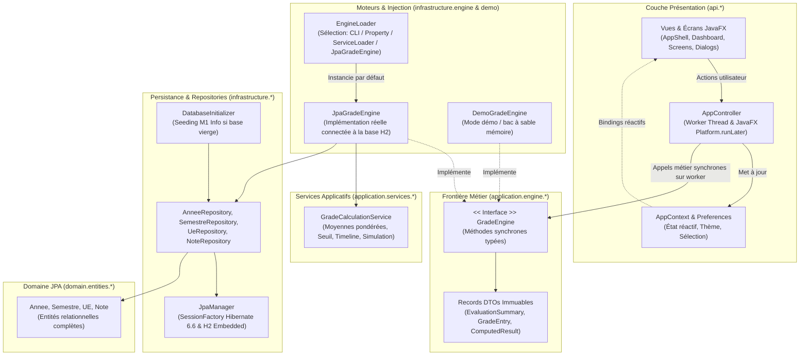

# Architecture Logicielle de MaNote

> Documentation d'architecture logicielle de l'application MaNote.
> Conforme aux exigences d'architecture MVC desktop, d'inversion de dépendance et de séparation stricte des
> responsabilités.

---

## 1. Vue d'Ensemble & Principes Architecturaux

L'application est structurée selon une architecture en couches étanche, respectant le patron **MVC (Modèle - Vue -
Contrôleur)** combiné au principe d'inversion de dépendance :

---

## 2. Découpage des Packages

| Package                       | Responsabilité                                                                                                                                               |
|-------------------------------|--------------------------------------------------------------------------------------------------------------------------------------------------------------|
| `api.views.app`               | Point d'entrée JavaFX (`MaNoteApp`), gestion du cycle de vie (`start`/`stop`), coquille de fenêtre (`AppShell`), vues Swing conservées (`App`, `BarreMenu`). |
| `api.views.screens`           | Les 8 écrans fonctionnels (Dashboard, Semestres, UE Details, Evaluations, Analytics, Planning, EngineConfig, Settings).                                      |
| `api.views.widgets`           | Bibliothèque de composants UI réutilisables (`StatCard`, `UECard`, `StatusBadge`, `EmptyState`, `TopBar`, `SidebarNavigation`).                              |
| `api.views.dialogs`           | Boîtes de dialogue ergonomiques (`EvaluationDialog`, `GradeDialog`, `ConfirmationDialog`).                                                                   |
| `api.views.format`            | Formatage localisé en français (`Formatters`), **garantissant qu'une note absente n'est jamais formatée à 0**.                                               |
| `api.controllers`             | Contrôleur principal (`AppController`), orchestration asynchrone sur worker thread et fermeture propre (`shutdown`).                                         |
| `api.model`                   | Contexte applicatif partagé (`AppContext`), destinations de navigation (`NavigationDestination`).                                                            |
| `application.engine`          | Contrat public du moteur (`GradeEngine`, `EngineInfo`, `EngineCapabilities`) et moteur persistant (`JpaGradeEngine`).                                        |
| `application.engine.model`    | Records DTOs immuables (`EvaluationSummary`, `GradeEntry`, `ComputedResult`, etc.).                                                                          |
| `application.engine.config`   | Description dynamique des configurations de calcul (`ConfigurationView`, `ConfigurationSection`, `ConfigValue`, etc.).                                       |
| `application.engine.error`    | Hiérarchie d'exceptions métier explicites (`ValidationException`, `NotFoundException`, `OperationNotSupportedException`).                                    |
| `application.services`        | Services de calcul métier (`GradeCalculationService` : calcul pondéré, timeline, simulations).                                                               |
| `infrastructure.persistence`  | Gestionnaire de session Hibernate (`JpaManager`), initialisation et migration automatique (`DatabaseInitializer`).                                           |
| `infrastructure.repositories` | Dépôts relationnels JPA (`AnneeRepository`, `SemestreRepository`, `UeRepository`, `NoteRepository`).                                                         |
| `infrastructure.engine`       | Découverte et injection du moteur (`EngineLoader`) via argument CLI, propriété JVM ou `ServiceLoader`.                                                       |
| `infrastructure.demo`         | Moteur de démonstration et jeu de données fictif (`DemoGradeEngine`, `DemoData`).                                                                            |
| `infrastructure.preferences`  | Persistance locale des réglages (`UserPreferences`).                                                                                                         |
| `domain.entities`             | Entités JPA du domaine (`Annee`, `Semestre`, `UE`, `Note`), mappées en base relationnelle.                                                                   |

---

## 3. Persistance Relationnelle & Base de Données Locale

1. **Base relationnelle H2 embarquée** :
    - Fichier de données persisté dans le répertoire utilisateur : `~/.manote/manote.mv.db`.
    - Connectivité multi-processus avec `AUTO_SERVER=TRUE` pour autoriser la consultation externe sans verrouiller
      l'application.
    - Mode `in-memory` (`jdbc:h2:mem:...`) disponible pour les tests unitaires via `JpaManager.resetForTesting(...)`.
2. **Fournisseur JPA Hibernate 6.6** :
    - Schéma de table synchronisé automatiquement (`hbm2ddl.auto = update`).
    - Transactions atomiques gérées via `executeInTransaction` et `executeInTransactionWithResult`.
    - Jointures `LEFT JOIN FETCH` optimisées dans les dépôts pour éviter le problème N+1 et garantir l'initialisation
      complète lors du détachement.
3. **Amorçage et configuration du cursus (`DatabaseInitializer` & `CurriculumYamlService`)** :
    - Par défaut, la base démarre totalement vierge (0 années, 0 semestres, 0 UE, 0 notes) pour une installation neuve.
    - L'étudiant peut configurer son cursus dynamiquement via l'interface graphique (boutons d'ajout d'années,
      semestres, UE et DS).
    - En alternative, un fichier YAML éditable est pris en charge à `~/.manote/cursus.yaml` (modèle généré dans
      `~/.manote/cursus.yaml.template`). S'il est présent et modifié, il est automatiquement synchronisé en base au
      démarrage ou à la demande via `CurriculumYamlService`.

---

## 4. Cycle de Vie d'une Action Utilisateur

1. **Déclenchement dans la Vue** : L'utilisateur clique sur une action (ex. *"Valider la note"* dans le `GradeDialog`).
2. **Transmission au Contrôleur** : La vue transmet la requête au `AppController` (ex.
   `controller.recordGrade(evalId, grade, callback)`). La vue ne contient aucun calcul mathématique.
3. **Délégation Asynchrone sur Worker Thread** :
    - `AppController` soumet la tâche à son `ExecutorService` d'arrière-plan (`MaNote-Engine-Worker`).
    - Le thread JavaFX n'est **jamais bloqué**, garantissant une fluidité constante même en cas d'accès base de données
      ou de calculs complexes.
4. **Exécution Métier et Persistance** : Le moteur persistant `JpaGradeEngine` met à jour l'entité `Note` via
   `NoteRepository` dans une transaction JPA, puis retourne le résultat.
5. **Retour sur le JavaFX Application Thread** :
    - Le contrôleur capture le résultat ou l'exception.
    - Il utilise `Platform.runLater()` pour répercuter le changement dans l'interface (toast de succès ou d'erreur, et
      rafraîchissement réactif de la vue).
6. **Arrêt Propre de l'Application** :
    - À la fermeture de la fenêtre principale, `MaNoteApp.stop()` invoque `controller.shutdown()`, libérant
      immédiatement le thread pool d'arrière-plan.

---

## 5. Inversion de Dépendance & Raccordement du Moteur Réel

L'interface graphique est strictement découplée de l'implémentation du moteur :

- Aucune vue ni contrôleur n'instancie directement `JpaGradeEngine` ou `DemoGradeEngine`.
- La référence vers `GradeEngine` est injectée via `EngineLoader.getEngine()`.
- L'utilisateur peut fournir son propre moteur :
    1. En ligne de commande via `--engine=mon.package.MonGradeEngine`
    2. En propriété JVM via `-Dmanote.engine.class=mon.package.MonGradeEngine`
    3. En SPI standard via `META-INF/services/application.engine.GradeEngine`
- Si le moteur réel ne fournit pas certaines options (ex. simulation ou modification de structure), l'interface consulte
  `engine.capabilities()` et masque proprement les boutons associés ou affiche un état informatif.

---

## 6. Système de Construction & Makefile

Le projet dispose d'une automatisation complète via un `Makefile` à la racine et dans le module :

- `make run` : lancement immédiat de l'UI JavaFX connectée aux données réelles H2.
- `make run-swing` : lancement du mode de compatibilité Swing hérité.
- `make test` : exécution de la suite complète de 30 tests unitaires JUnit 5.
- `make package` : construction du JAR exécutable.
- `make lint` : compilation avec avertissements stricts du compilateur (`javac -Xlint:all`).
- `make clean` : suppression des fichiers de build.
